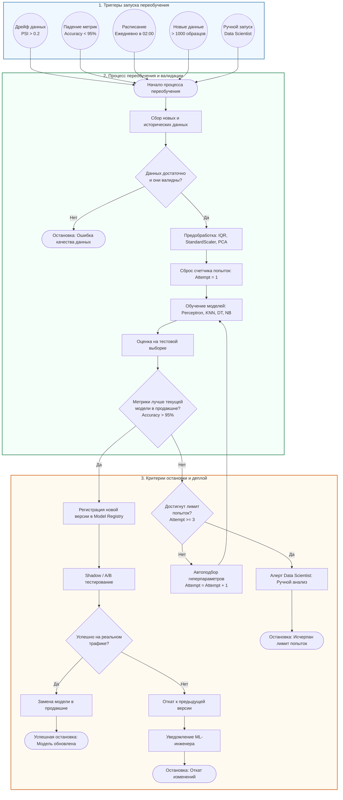

# BPMN-диаграмма процесса автоматического переобучения модели

## Описание процесса
Данная диаграмма описывает автоматизированный цикл переобучения (Retraining) и замены модели классификации рака груди в продакшене, включая триггеры запуска, этапы обучения и критерии остановки.

## Диаграмма процесса (Mermaid)

## Ключевые компоненты диаграммы

### 1. Триггеры (Triggers)
* **Data Drift:** Индекс стабильности популяции (`PSI > 0.2`).
* **Degradation:** Снижение точности (`Accuracy < 95%`) или полноты (`Recall < 95%`).
* **Scheduled:** Плановый запуск по расписанию (ежедневно в 02:00).
* **Data Volume:** Накопление более 1000 новых размеченных образцов.
* **Manual:** Принудительный запуск специалистом.

### 2. Критерии остановки (Stopping Criteria)
Процесс автоматически завершается в одном из следующих случаев:
1. **Успешное обновление (Success):** Новая модель превзошла текущую по метрикам, прошла A/B-тест и выведена в продакшн.
2. **Исчерпан лимит попыток (Max Attempts Reached):** Выполнено 3 цикла переобучения с тюнингом гиперпараметров без улучшения качества (передача задачи человеку).
3. **Ошибка валидации данных (Data Quality Failure):** Обнаружены критические аномалии или нехватка данных до начала обучения.
4. **Провал A/B-теста (Rollback):** Деградация метрик на реальном трафике — автоматический откат к стабильной версии.
