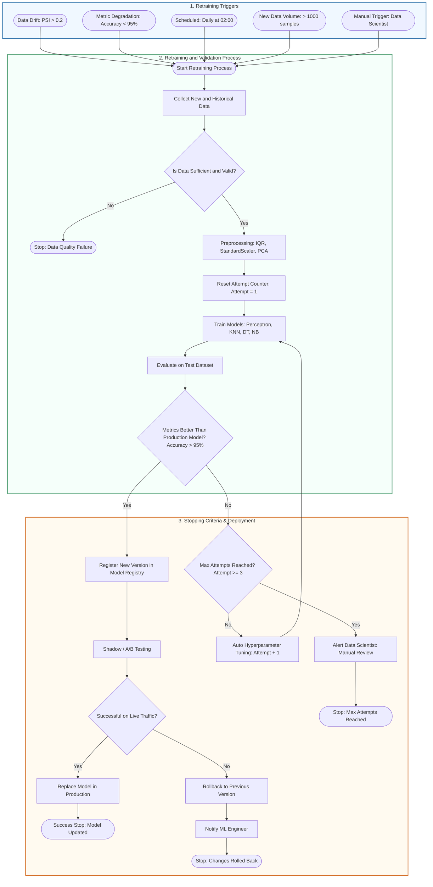

# Automated Model Retraining BPMN Diagram

## Process Description
This diagram illustrates the automated retraining and model replacement lifecycle for the breast cancer classification model in production, including trigger events, training steps, and stopping criteria.

## Process Diagram (Mermaid)

## Key Diagram Components

### 1. Triggers
* **Data Drift:** Population Stability Index (`PSI > 0.2`).
* **Degradation:** Drop in accuracy (`Accuracy < 95%`) or recall (`Recall < 95%`).
* **Scheduled:** Cron-based scheduled execution (daily at 02:00).
* **Data Volume:** Accumulation of more than 1,000 newly labeled samples.
* **Manual:** On-demand execution triggered by a specialist.

### 2. Stopping Criteria
The pipeline automatically terminates under one of the following conditions:
1. **Successful Update (Success):** The challenger model outperforms the production model, passes A/B testing, and is deployed.
2. **Max Attempts Reached:** 3 retraining iterations with hyperparameter tuning fail to improve metrics (escalated to human review).
3. **Data Quality Failure:** Critical anomalies or insufficient sample sizes are detected prior to training.
4. **A/B Test Failure (Rollback):** Metric degradation occurs on live traffic, triggering an automatic rollback to the stable version.
